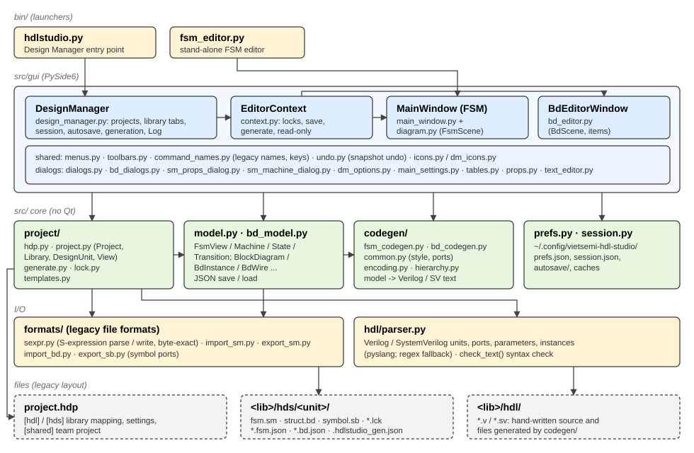

# Vietsemi HDL Studio architecture

How the code is organised and how data flows through it. Read this before changing the code;
the docstrings of each module go into the details.

## 1. Principles

1. **HDL is the source of truth.** Generated Verilog / SystemVerilog lives in the library's
   `hdl/` folder like hand-written code; diagrams are a way to produce it.
2. **Same files as the legacy tool.** Projects (`.hdp`), library folders (`<lib>/hdl`, `<lib>/hds/<unit>/`),
   state diagrams (`.sm`), block diagrams (`.bd`), symbols (`.sb`) and locks (`.lck`) are read in
   the legacy formats, so a team can use both tools on one project. State diagrams are written back
   into the `.sm` they came from; block diagrams are saved as `struct.bd.json` next to the `.bd`
   (see [roadmap.md](roadmap.md)).
3. **Same output as the legacy tool.** The generators reproduce its text layout exactly (order
   of declarations, indentation, comments), checked against the HDL it generates.
4. **Same behaviour as the legacy tool.** Menus, shortcuts, popup menus, dialogs and editing
   gestures follow the legacy tool as observed; comments in the code that say "as the legacy
   tool does" record such an observation. Commands not implemented yet are shown greyed at
   their legacy place.
5. **Verilog and SystemVerilog only** (no VHDL), Windows and CentOS Stream 9.

## 2. Module map (`src/`)

`src/` is the top level of the code: `bin/` puts it on `sys.path`, so modules are imported by
their own names (`from model import FsmView`, `from gui.bd_editor import BdEditorWindow`).
Inside a sub-package, modules import each other relatively (`from .icons import icon`).

| Module | Responsibility |
|---|---|
| `model.py` | State diagram data model: `FsmView` (one view) > `Machine` > `State`, `Junction`, `Link`, `Point`, `Transition`; `Signal`, `Parameter`. JSON save / load. |
| `bd_model.py` | Block diagram data model: `BlockDiagram` > `BdInstance` (+ `BdPin`), `BdEmbedded`, `BdPortIo`, `BdWire`, `BdFrame`, `BdComment`, `BdJunction`. |
| `formats/sexpr.py` | Parser / writer of the S-expression text of `.sm` / `.bd` / `.sb`. Writing back an unchanged document gives the same bytes. |
| `formats/import_sm.py`, `formats/import_bd.py` | Legacy file -> model. Keep the file's geometry in the `orig` dicts of the model objects. |
| `formats/export_sm.py` | Model -> `.sm`: re-reads the original file and changes only what was edited. |
| `formats/export_sb.py` | Keeps a unit's `symbol.sb` ports in step with its diagram's ports. |
| `formats/names.py` | The names the legacy project format fixes (`.hdp` sections, path variables, the graphics folder name): the only place the code spells them. |
| `hdl/parser.py` | Units, ports, parameters and instances of HDL files (pyslang); syntax check of editor text. |
| `codegen/fsm_codegen.py`, `codegen/bd_codegen.py` | Model -> HDL text. `common.py` holds the shared formatting and the generation style (Options > Verilog > Style). |
| `codegen/encoding.py`, `codegen/hierarchy.py` | State encodings; flattening of hierarchical states before generation. |
| `project/hdp.py`, `project/project.py` | `.hdp` reading / writing; `Project`, `Library`, `DesignUnit`, `View`; library scanning. |
| `project/generate.py` | Generate a unit's file into its library, with overwrite protection. |
| `project/lock.py`, `project/templates.py` | Edit locks; content of new design units. |
| `homes.py` | The configuration folders: `~/hdl_studio/user` and `team`, one folder per release. |
| `prefs.py`, `session.py` | User preferences; saved session, autosave of unsaved work. |
| `gui/design_manager.py` | The Design Manager window, and the coordinator of the application. |
| `gui/context.py` | `EditorContext`: what an editor knows about the project (locks, save, generate). |
| `gui/main_window.py`, `gui/diagram.py` | State diagram editor window and its canvas / items. |
| `gui/bd_editor.py` | Block diagram editor window, canvas, items and routing. |
| `gui/text_editor.py` | HDL text editor. |
| `gui/menus.py`, `gui/toolbars.py`, `gui/command_names.py` | Menu bars, toolbars (Standard, ... Tools, HDL Tools, Tasks), legacy command names, tool tips and shortcuts. |
| `gui/editor_common.py`, `gui/panels.py`, `gui/find_dialog.py`, `gui/expression_builder.py` | Commands both diagram editors share: print, Copy Picture, Align / Distribute, Back / Forward history, Open Up, Document And Visualize; panels; the legacy Find and Replace dialog (each editor lists its texts as `TextField`s by the legacy object kinds); the Expression Builder dialog. |
| `gui/editor_icons.py`, `gui/dm_icons.py`, `gui/icons.py` | Icons drawn with QPainter (editor toolbars, Design Manager, shared Refresh). |
| `gui/tables.py`, `gui/table_page.py`, `formats/sheet.py` | Signals Table and Parameters Table pages: the legacy spreadsheet drawn from the table layout of the view (`signals_sheet` / `params_sheet`, read from the legacy file's Sheet by formats/sheet.py: column widths, frozen columns, row order, cell formats), editing, and the table pages' own menus and toolbars (Table menu, SM Signals Tools, Appearance). |
| `gui/undo.py` | Snapshot undo / redo; per-view zoom and scroll memory. |
| other `gui/*` | Dialogs and panels (see each module's docstring). |

The layers only call downwards: `gui` uses everything, `project` uses `formats`, `hdl` and
`codegen`, the models use nothing. Everything outside `gui/` runs without Qt, so scripts and
tests can open projects, read diagrams and generate HDL directly.

## 3. Data model

* Coordinates are **scene units** = legacy file units / 75 (`formats.import_sm.SCALE`). The
  editors' grid is 1000 file units (`gui.diagram.GRID`).
* Objects read from a legacy file have the id `n<label>` (the `*N` label in the file), which lets
  `export_sm` find the original object again. New objects get other ids until they are saved.
* Geometry from the legacy file that the model does not need for generation (text boxes, line
  positions, ...) is kept in each object's `orig` dict. The editors draw from it while the
  object's texts are still the ones it was saved with (`orig['sig']`); after an edit they lay the object out themselves.
* A block diagram net is the set of `BdWire`s with the same `net` name plus the `Signal` of that
  name (type, bounds). Wire ends are attached with references: `pin:<instance id>:<pin>`,
  `pio:<id>`, `emb:<id>`, `jct:<id>`, or '' for a dangling end.

## 4. Main flows

### Opening a project
`DesignManager.load_project` -> `project.open_project` reads the `.hdp` (and the shared `.hdp`),
creates the `Library` objects and reports problems (unset variables, missing folders) in the
Log. A library is scanned (`Library.scan`) when its tab is opened: HDL files are parsed (cached
by modification time, the cache is kept between runs), graphics folders give the views.

### Opening and editing a view
`DesignManager.open_view` -> `project.generate.load_view` reads the view (`import_sm` /
`import_bd`, or the `.json`) -> an `EditorContext` locks it (`.lck`) -> the editor window
(`MainWindow` or `BdEditorWindow`) is created with the model and the context.

In the editor the scene (`FsmScene` / `BdScene`) edits the model objects directly and emits
`changed_model`. The window then marks itself dirty, lets `SnapshotUndo` take a snapshot (a
burst of edits is one undo step) and regenerates the HDL in memory after a short delay (for
warnings and the design rule check).

### Saving
`EditorContext.save`: a state diagram read from a `.sm` is written back with
`export_sm(view, src, dst, geometry)` (the editor passes the lines as drawn); its symbol is
updated when the ports changed. Other views are saved as `<view>.<kind>.json`.

### Generating
`gui.context.generate_with_prompt` -> `project.generate.generate_unit`: the header comes from the
preferences, the text from `codegen`, the file name from the naming rule. The hash of every file
written is kept in `<graphics folder>/<unit>/.hdlstudio_gen.json`; a file whose content no longer matches was
edited by hand, so the user is asked before it is overwritten. Tasks > Generate through
blocks / components / design root walks the hierarchy (`EditorContext.generate_hierarchy`).

### Session and crash protection
`DesignManager.session_snapshot` records the project, library tabs and editor windows; it is
saved whenever editor windows or library tabs open and close (and at exit, with the window
places), and restored at start-up. Every N minutes the
unsaved model of each editor is written to the autosave folder; opening a view with an
autosave offers to recover it.

## 5. Where things are configured

| What | Where |
|---|---|
| User preferences (Options dialogs) | `~/hdl_studio/user/v2026.12/user_prefs.json` (`src/homes.py`; `$HDLSTUDIO_HOME`, `$HDLSTUDIO_USER_HOME` move it) |
| Session, autosave, caches | the same folder: `session.json`, `autosave/`, `hdl_cache.pickle`, `hier_cache_v2.json` |
| Team settings | `~/hdl_studio/team/` (`$HDLSTUDIO_TEAM_HOME`): `shared.hdp`, `v2026.12/` |
| Zoom / scroll per diagram | Qt settings ("Vietsemi" / "HDL Studio") |
| Project and libraries | the `.hdp` file |
| Default views of a library | `<lib>/hds/.hdlstudio_default_views.json` |
| Generation records | `<lib>/hds/<unit>/.hdlstudio_gen.json` |

## 6. Extending the tool

* **A new editor command:** create the action in the editor's `_build_actions` /
  `_build_menu_commands` under a key; give the key its legacy name, tool tip and status text in
  `gui/command_names.py`, its shortcut in `gui/toolbars.py` (`FSM_KEYS` / `BD_KEYS`), and its
  place in `gui/menus.py` (`@key`, or `@key=Label` for the label shown greyed while the window has no
  such command) and, for a button, in `FSM_TOOLBARS` / `BD_TOOLBARS` with an icon in `gui/editor_icons.py`.
  An entry that exists in the legacy tool but not yet here is greyed (`'!text'` for one that never
  will be). A command that needs a selection is enabled in the window's `update_menu_states`.
  Add a check to `tests/test_editors.py`.
* **A generation rule:** change `codegen/`, then run the unit tests and compare with the HDL the
  legacy tool generates: the output must stay identical to it.
* **Another legacy object in a `.sm`:** read it in `formats/import_sm.py` (keep its geometry in
  `orig`), write it in `formats/export_sm.py` (from the templates the file holds), draw it in
  `gui/diagram.py`; check that a file saved without edits is written back byte for byte. Write
  what you learned about the object in `resources/scripts/format_notes.py` and run
  `python resources/scripts/format_ref.py` to update
  [formats/sm-sb-bd-reference.html](formats/sm-sb-bd-reference.html).
* **A preference:** add a field with a default to `prefs.Prefs` (old preference files keep
  working), a widget to the dialog, and read it where it is used.

See [development.md](development.md) for the working conventions and the tests.
